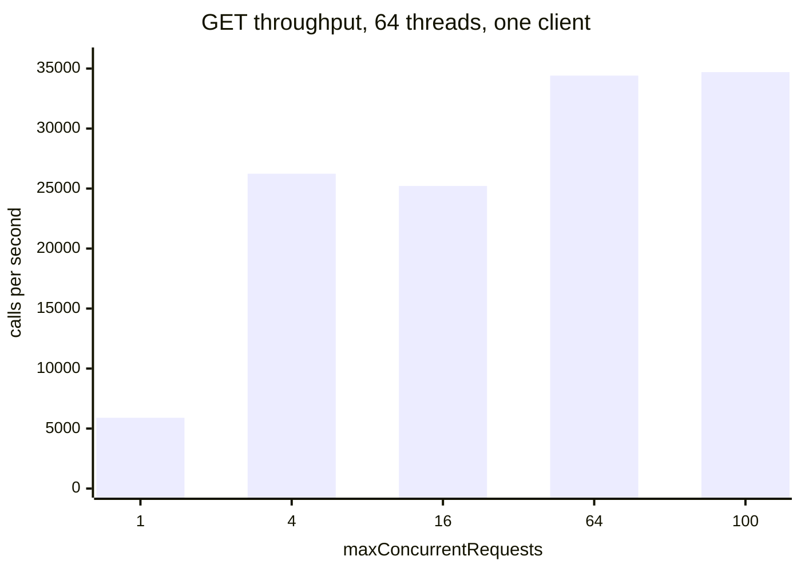

# Performance

Previous: [Authentication in depth](authentication.md) · [Guide index](README.md)

These figures were measured on a single machine against a local stub server. They show the cost the library adds to a
call: request building, rate-limit bookkeeping, the conditional cache, reading the body and JSON decoding. They do not
include network latency, TLS or GitHub's own response time, which in practice dominate.

<b>Methodology and environment</b>

| Item | Value |
|---|---|
| Machine | 8 vCPU Intel Xeon (1 thread per core), 15 GiB RAM, Debian 13 (Linux 6.12) |
| JVM | OpenJDK 21.0.12.1; heap `-Xmx512m` to `-Xmx2g` for the probes, JMH defaults for benchmarks |
| Server | Local JDK `HttpServer` stub over plain HTTP on loopback, `TCP_NODELAY`; no TLS, no real network |
| Responses | Issue: 7 KB JSON. Lists: 100 or 1,000 issues per page. Large bodies: 1 to 64 MiB, with `Content-Length` or chunked |
| Client | `GitHubClients.create(...)` with defaults unless a row says otherwise (`maxConcurrentRequests` 1, conditional cache 64 entries / 4 MiB) |
| Benchmarks | JMH, 3 forks, `SampleTime` mode, 99.9% confidence intervals, `-prof gc` for allocation |
| Probes | Plain Java programs for lifecycle, memory, virtual threads and pagination. They read `ThreadMXBean` allocation counters, heap after GC, `/proc` file descriptors and sockets, and JFR (`jdk.VirtualThreadPinned`) |

JMH allocation figures (`B/op`) count every thread in the JVM, including the stub's server threads. The probe figures
marked "client thread" count only the calling thread, which is closer to what the library itself allocates.

## Per-call overhead

A single `GET` of a 7 KB issue takes about 0.1 ms of client CPU and allocates about 90 KB on the calling thread. A
conditional-cache hit (a 304 answered from memory) costs slightly less than a full fetch. GitHub's timestamps
(`2024-05-17T10:22:33Z`) are decoded without `DateTimeFormatter`.

Per-call table

| Call (1 thread, default client) | Mean time | p50 | p99 | Allocation |
|---|---|---|---|---|
| `GET` issue, 7 KB (JMH) | 281 ± 133 µs | 202 µs | 499 µs | 147 KB/op (all threads) |
| `GET` issue, conditional-cache hit (JMH) | 271 ± 127 µs | 200 µs | 493 µs | 144 KB/op (all threads) |
| `GET` issue without `ETag` (JMH) | 257 ± 118 µs | 193 µs | 428 µs | 139 KB/op (all threads) |
| `GET` issue (probe, client thread) | 153–158 µs wall, 96–100 µs CPU | | | 89.4–89.6 KB/op |
| `GET` issue, cache hit (probe, client thread) | 124 µs wall, 73.5 µs CPU | | | 88.4 KB/op |
| Decoding one `Instant` | 221–227 ns | | | |

## Pagination

Walks are lazy: `stream().limit(150)` over 100-item pages fetched 2 pages. Walking with `stream()` or `forEachPage(...)`
keeps memory flat however many pages there are. `all()` keeps every item, so it grows with the result. See
[Pagination](../../README.md#pagination).

Pagination table

| Walk (pages × items, default client) | Pages fetched | Time per item | Heap peak | Allocation per item |
|---|---|---|---|---|
| `list` one page of 100 (JMH) | 1 | 38.6 µs (3,862 ± 226 µs per page) | | 41.6 KB (all threads) |
| `list` one page of 1,000 (JMH) | 1 | 34.8 µs (34.8 ± 2.9 ms per page) | | 40.8 KB (all threads) |
| `stream().limit(150)`, 10 × 100 | 2 | 120 µs | 22 MiB | 58 KB |
| `stream()`, 1,000 × 100 | 1,000 | 39.6 µs | 180 MiB | 41 KB |
| `forEachPage(...)`, 1,000 × 100 | 1,000 | 39.3 µs | 169 MiB | 41 KB |
| `all()`, 1,000 × 100 | 1,000 | 49.0 µs | 1,184 MiB | 41 KB |

All walks start from a 16 MiB heap. The per-item figures for the 10-page walks include the first call of a fresh JVM.

## Concurrency and throughput

By default a client sends one request at a time (see [Concurrency and pacing](rate-limiting.md#concurrency-and-pacing)). Its throughput
therefore stays flat however many threads share it: about 5,700 to 5,900 small `GET`s per second here. Raising
`maxConcurrentRequests` raises throughput until the machine is saturated. Threads waiting for a request slot hold little
memory, and 1,000 virtual threads ran without pinning events.

Throughput and latency by concurrency limit

`GET` issue, one shared client, JMH `SampleTime`, 3 forks. Throughput = threads ÷ mean latency.

| `maxConcurrentRequests` | Threads | Mean latency | p50 | p99 | Throughput |
|---|---|---|---|---|---|
| 1 (default) | 1 | 436 ± 9 µs | 413 µs | 943 µs | 2,295 calls/s |
| 1 (default) | 16 | 2,821 ± 21 µs | 2,257 µs | 5,972 µs | 5,672 calls/s |
| 1 (default) | 64 | 10,851 ± 48 µs | 8,815 µs | 20,054 µs | 5,898 calls/s |
| 4 | 64 | 2,439 ± 6 µs | 2,167 µs | 6,586 µs | 26,237 calls/s |
| 16 | 64 | 2,538 ± 8 µs | 2,196 µs | 7,414 µs | 25,214 calls/s |
| 64 | 64 | 1,860 ± 10 µs | 1,219 µs | 9,503 µs | 34,409 calls/s |
| 100 | 16 | 445 ± 2 µs | 329 µs | 2,335 µs | 35,976 calls/s |
| 100 | 64 | 1,844 ± 10 µs | 1,274 µs | 9,454 µs | 34,703 calls/s |
| 1 (default), list of 100 | 16 | 13.5 ± 0.1 ms | 12.7 ms | 21.9 ms | 1,183 lists/s |
| 100, list of 100 | 16 | 7.7 ± 0.1 ms | 6.9 ms | 20.7 ms | 2,067 lists/s |

Virtual threads, overload and slot waits

1,000 virtual threads, 5 `GET`s each, one shared client:

| `maxConcurrentRequests` | Result | Wall time | Throughput | p50 / p99 latency | Heap peak (from 14 MiB) | Platform threads | JFR pinning events |
|---|---|---|---|---|---|---|---|
| 1 (default) | 5,000 ok, 0 errors | 1,919 ms | 2,606 calls/s | 302 / 668 ms | 160 MiB | 26 | 0 |
| 100 | 5,000 ok, 0 errors | 832 ms | 6,008 calls/s | 144 / 206 ms | 202 MiB | 30 | 0 |

Overload: 1,000 virtual threads, one call each, limit 1, `maxSlotWait` 5 s, stub answering in 20 ms. 231 calls
succeeded. The other 769 failed with a slot-wait timeout after 5.03 s (p50 5,027 ms, max 5,045 ms), and the heap peaked
at 39 MiB. The next call succeeded.

A call made from inside a `stream(...)` handler on a client with limit 1 waits for its own slot. It fails after
`maxSlotWait` (2 s configured: failed after 2,065 ms) with "no free request slot … a call made from inside a stream
handler can wait for its own slot", and the client keeps working afterwards.

## Memory

Client footprint and conditional cache

| Measurement | Value |
|---|---|
| Heap retained by an idle client (1,000 live clients, no calls) | about 41 KB per client (9.1 → 49.7 MiB) |
| Heap retained by a client after one `GET` (1,000 live clients) | about 61 KB per client (12.1 → 73.4 MiB) |
| Heap retained by a client with a full conditional cache, defaults (200 clients × 300 distinct URLs) | 0.88 MiB per client |
| Heap after closing all of them | back to baseline (9.3 MiB and 12.3 MiB) |

The cache limits are described in [Conditional requests](rate-limiting.md#conditional-requests).

Large responses: buffered and <code>stream(...)</code>

A buffered response is read into memory in full, up to `maxResponseBytes` (64 MiB by default). A body with
`Content-Length` needs about 1.5 times its size while it is read. A chunked body needs 2 to 3 times its size: 3.0 times
was measured for 16 MiB over OkHttp. `stream(...)` hands over the body without buffering it.

| 16 MiB body, 1 thread | Allocation per call (caller thread) | Heap peak |
|---|---|---|
| Buffered, `Content-Length` | 1.50 × body | 66 MiB |
| Buffered, chunked | 3.02 × body | 97 MiB |
| `stream(...)`, read in 16 KB blocks | 0.13 × body | 18 MiB |

- One byte over 64 MiB fails with `ResponseTooLargeException` ("Response body exceeds the limit of 67108864 bytes"),
  with no `OutOfMemoryError` (heap peak 19 MiB).
- 16 concurrent buffered 16 MiB responses (limit 16) completed 32/32 on a 512 MiB heap, with a peak of 496 MiB. Memory
  for buffered bodies can reach `maxConcurrentRequests` × body size. Use `stream(...)` for large downloads.

## Client lifecycle

Creating a client takes well under a millisecond. `close()` releases its connections and threads. A client that is
never closed keeps its pooled sockets until the connection keep-alive ends (5 minutes by default), so close clients you
no longer need (see [Close the client](../../README.md#close-the-client)) and share one per credential (see
[Create a client](../../README.md#create-a-client)).

Lifecycle table

| Measurement | Value |
|---|---|
| Create + close, no call (10,000 clients) | 68 µs create, 3.5 µs close, 62 KB allocated per client |
| Create + one `GET` + close (3,000 clients) | 220 µs create, 941 µs first call (new connection), 58 µs close, 167 KB per client |
| Threads, fds and sockets after 10,000 create/close cycles | unchanged (8 threads, 16 fds, 4 sockets) |
| 1,000 live clients after one `GET` each | 1,204 sockets open, back to 4 after `close()` |
| 3,000 clients never closed (default keep-alive 5 min) | 3,004 sockets held, released between 294 s and 312 s |
| 3,000 clients never closed, `connectionKeepAlive` 5 s | released within 5 s |

---

Previous: [Authentication in depth](authentication.md) · [Guide index](README.md)
